# NŌTA — Complete End-to-End Technical Architecture Document
**System Architecture, Component Design, Data Flow, Security, and Deployment Specification**

---

## 1. NŌTA — Product & Application Overview

### 1.1 What is NŌTA?
**NŌTA** (*“Make room for thought.”*) is a high-performance, minimalist digital writing studio engineered for writers, researchers, essayists, and developers. Built on a strict **local-first, zero-telemetry architecture**, NŌTA gives thoughts a quiet, distraction-free environment to exist without account walls, cookie tracking, cloud lock-in, or nested interface clutter.

### 1.2 Primary Purpose & Business Objectives
- **Distraction Elimination:** Strip away the cognitive overhead typical of modern productivity dashboards (e.g., Notion, Evernote, Google Docs) in favor of typography, whitespace, and immediate focus.
- **Data Sovereignty & Absolute Privacy:** Guarantee that user notes never leave the client device by executing all data storage, indexing, sanitization, parsing, formatting, and file export operations client-side in the browser.
- **Deterministic Reliability & Zero Latency:** Ensure 0ms keystroke persistence and offline-first availability without dependence on cloud databases, active internet connectivity, or background network sync threads.
- **Truthful Status Reporting:** Enforce strict save verification where the UI displays `Saved` only after the browser's storage engine confirms synchronous write completion.

### 1.3 Problems Solved
1. **Cloud Capture Friction:** Eliminates mandatory sign-up flows, email verification, passwords, and server latency when capturing transient ideas.
2. **Surveillance & Data Exploitation:** Protects private manuscripts and journals from server-side indexing, LLM training scrapers, analytics tracking, and data breaches.
3. **Bloated UI Interfaces:** Replaces multi-layered toolbars, floating widgets, and complex card systems with an editorial layout adhering to strict typography rules (68ch/86ch measure, optical margins, hairline dividers).
4. **Data Lock-in:** Prevents proprietary database lock-in by providing instant UTF-8 Plain Text (`.txt`) export, validated file imports (`.txt`, `.md`, `.markdown`, `.json`), and raw complete JSON studio backups.

### 1.4 Core Features & Functionalities
- **Distraction-Free Writing Canvas:** High-legibility text editor featuring native dynamic height expansion (`[field-sizing:content]`), custom typographic scales, spell-checking, and hairline dividers.
- **Typography Engine:** Seamless on-the-fly switching between **Editorial Serif** (`Lora`/`Instrument Serif`), **Refined Sans** (`Inter`), and **Technical Monospace** (`JetBrains Mono`).
- **Zen Focus Mode (`⌘\` / `Ctrl+\`):** Hides the navigation sidebar and auxiliary controls to isolate the manuscript canvas.
- **Command Palette & Keyboard Navigator (`⌘K` / `Ctrl+K`):** Spotlight-style command palette enabling instant fuzzy-search jump-to-note, formatting triggers, and productivity actions.
- **Real-Time Text Metrics Telemetry:** Low-overhead live word count, character count, space-excluded character count, paragraph count, and reading time estimation calculated on every text modification.
- **Local-First Collection Management:** Organization into structured categories (`Essays`, `Journal`, `Drafts`, `Ideas`), note pinning (`pinned: true`), note duplication, and soft/hard deletion with confirmation.
- **Truthful 4-State Autosave:** Real-time state machine displaying `Saving...`, `Saved`, `Unable to save`, and `Retrying...` with quota exhaustion alerting.
- **Secure File Import Engine:** 2 MB capped, extension-whitelisted (`.txt`, `.md`, `.markdown`, `.json`), binary null-byte-rejecting parser running entirely client-side via the Web File API.
- **Universal Export Suite:** UTF-8 `.txt` single-note export with normalized slug filenames and full studio `.json` backup downloads.
- **PWA & Offline Capability:** Standalone Progressive Web App compliance with web manifest, high-resolution icons (180px, 192px, 512px, maskable), and install prompts.

### 1.5 User Types & Personas
Because NŌTA operates without server authentication or multi-tenant database roles, user differentiation is client-side and behavioral:
1. **The Long-Form Essayist / Novelist:** Relies on the 68ch measure, Editorial Serif font, Zen Focus mode, paragraph counters, and `.txt` chapter exports.
2. **The Daily Journaler:** Uses the `Journal` category filter, date-based sort order (`Recent`), and dark mode (`#0B0B0D`) for nighttime reflections.
3. **The Technical Researcher / Developer:** Relies on Technical Monospace (`JetBrains Mono`), inline code syntax formatting (`` `code` ``), and Markdown file imports.
4. **The Ephemeral Ideator:** Quickly launches NŌTA via browser shortcut or PWA home-screen icon, captures thoughts with zero loading delay, and copies text to clipboard in one keystroke (`⌘⇧C`).

### 1.6 User Journey
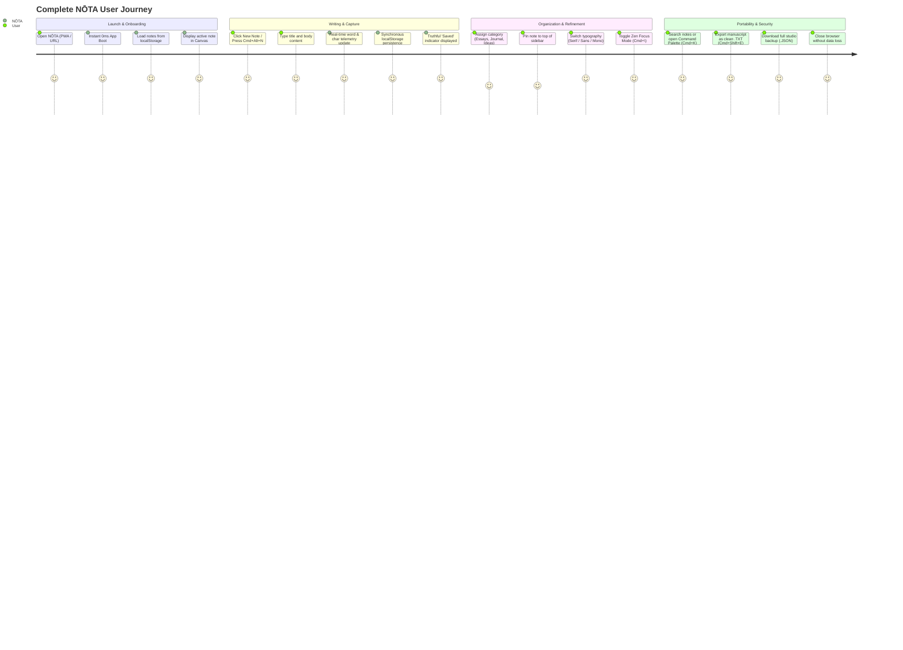

---

## 2. High-Level Architecture (HLD)

NŌTA is architected as an **Edge-Distributed, Client-Authoritative Local-First Single Page Application (SPA)**. It leverages modern web runtime primitives (DOM, Web Storage API, File API, Clipboard API) served through high-performance edge content delivery networks (Vercel Edge / Cloud Run proxy).

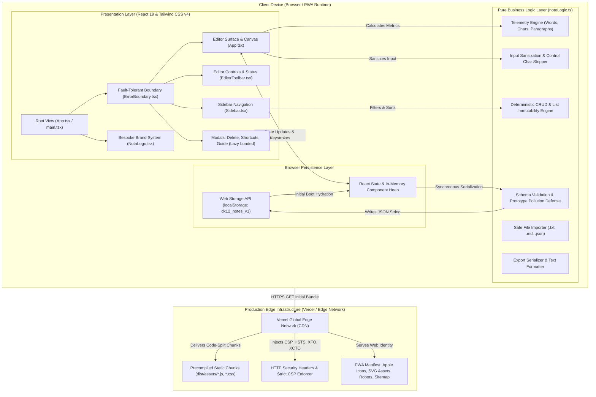

### Component Communications & Responsibilities
| Component / Tier | Responsibilities | Communication Method |
| :--- | :--- | :--- |
| **Vercel Edge Network** | Serves static assets, enforces strict Content Security Policy, handles SPA rewrites, terminates TLS 1.3. | HTTP/2 & HTTP/3 HTTPS |
| **Presentation Tier** | Renders distraction-free writing surface, responds to keyboard shortcuts, manages UI focus and accessibility tree. | React 19 Synthetic Events, Props, Refs |
| **Pure Logic Tier** | Pure, deterministic functional engine (`noteLogic.ts`) responsible for metrics, input cleansing, list mutations, and file parsing. | Extensionless ES Module Imports, In-Memory Function Calls |
| **Storage Engine** | Synchronous browser `localStorage` providing persistence across page reloads and browser sessions without network dependencies. | Web Storage API (`getItem`, `setItem`, `removeItem`) |

---

## 3. Frontend Architecture

### 3.1 Application Structure & Component Tree
The application is structured into atomic, highly cohesive React components:

```
src/
├── App.tsx                     # Primary workspace container, global shortcut listeners, persistence state machine
├── main.tsx                    # Application entry point, mounts ErrorBoundary and Strict React root
├── index.css                   # Tailwind v4 import, CSS custom properties, design tokens, reduced-motion rules
├── components/
│   ├── NotaLogo.tsx            # Custom SVG Brand wordmark and compact architectural emblem
│   ├── Sidebar.tsx             # Collapsible notes drawer, live search, status tabs, category chips, note cards
│   ├── EditorToolbar.tsx       # Top bar: Focus toggle, category dropdown, typography switcher, autosave status
│   ├── DeleteModal.tsx         # Accessible, focus-trapped note deletion confirmation modal (Lazy Loaded)
│   ├── ShortcutsModal.tsx      # Command palette (`⌘K`) with jump-to-note and action runner (Lazy Loaded)
│   ├── AboutGuideModal.tsx     # 4-tab documentation modal: Guide, FAQ, Privacy, Terms (Lazy Loaded)
│   └── ErrorBoundary.tsx       # React Class Component error boundary with emergency JSON backup trigger
└── utils/
    ├── noteLogic.ts            # Decoupled pure business logic, input sanitizers, parsers, and type contracts
    └── noteLogic.test.ts       # 8-suite unit test runner executing via node:test and npx tsx
```

### 3.2 Component Architecture Diagram
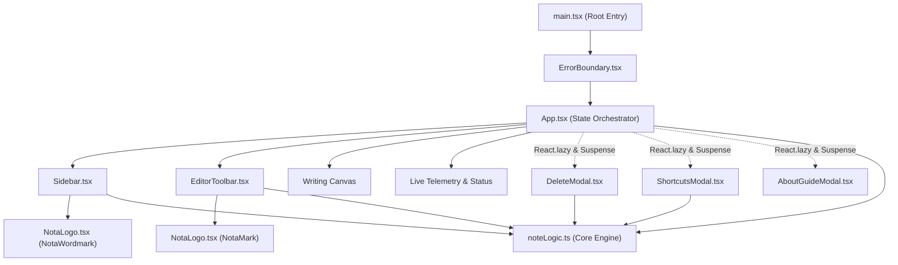

### 3.3 State Management & Hooks
NŌTA relies on **idiomatic React 19 state primitives** paired with synchronous storage persistence:
- `notes: Note[]`: Authoritative array of note objects.
- `activeNoteId: string | null`: Currently edited note identifier, with automatic fallback resolution to `notes[0].id`.
- `isDark: boolean`: Theme state synchronized with `<html class="dark">` and `dx12_theme_v1`.
- `editorFont: EditorFont ('serif' | 'sans' | 'mono')`: Active font family choice.
- `isWideMeasure: boolean`: Canvas reading width toggle (`68ch` vs `86ch`).
- `saveStatus: SaveStatus ('saved' | 'saving' | 'error' | 'retrying')`: Truthful storage state machine.
- `storageWarning: string | null`: Quota exhaustion warning banner.
- `searchQuery: string`, `filterMode: FilterMode`, `selectedCategory: NoteCategory | 'All'`: Filter predicates.

### 3.4 Responsive Design System
The responsive system supports 7 distinct display classes (`360px`, `390px`, `430px`, `768px`, `1024px`, `1440px`, `1920px`):
- **Desktop (>= 1024px):** Permanent two-column layout with a 72-rem sidebar and spacious canvas. Zen Focus mode (`⌘\`) collapses the sidebar with smooth CSS transitions.
- **Mobile (< 1024px):** Off-canvas drawer with backdrop blur (`bg-[#171614]/45`), touch-friendly targets (minimum 44x44px), sticky bottom formatting bar, and automatic drawer auto-close on note selection.

---

## 4. Backend & Edge Architecture

### 4.1 Architecture Classification: Static Edge Single Page Application
NŌTA operates in production as an **Edge-Delivered Static Single Page Application**. 
- There is **no persistent centralized backend application server or SQL/NoSQL database process** required for note storage.
- All note management, encryption boundary considerations, persistence, search indexing, and export transformations run exclusively on the client device.
- Static assets are distributed globally via **Vercel's Global Edge Network**, ensuring sub-50ms Time to First Byte (TTFB) anywhere in the world.

### 4.2 Local Development Server & Full-Stack Bridge
In the local development environment, Vite 8 runs on `http://localhost:3000` with Node.js support. While the application is client-first, the environment retains full capability for Express middleware integration via `server.ts` or serverless API routes (`/api/*`) should cloud synchronization or Google Gemini AI features be provisioned in the future.

### 4.3 Static Request Lifecycle on Vercel
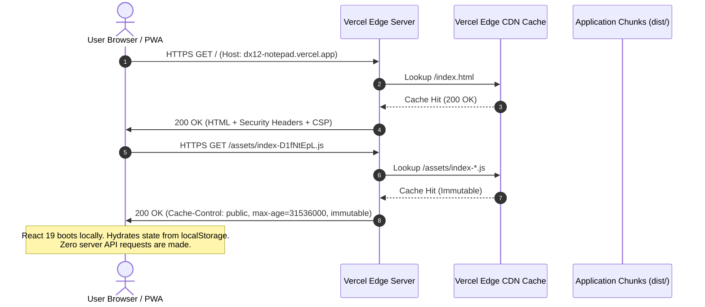

---

## 5. Database & Persistence Architecture

### 5.1 Storage Technology: Client-Side Web Storage API
NŌTA uses browser **`localStorage`** as its persistence engine. The choice of `localStorage` provides:
1. **Synchronous durability:** Guarantees that write operations complete before the thread proceeds.
2. **Zero installation overhead:** Supported out of the box in 100% of modern web browsers.
3. **Storage isolation:** Sandboxed strictly by browser Origin (`scheme + domain + port`).

### 5.2 Storage Schema Specification
The storage namespace is managed via structured keys:
| Key | Type | Description |
| :--- | :--- | :--- |
| `dx12_notes_v1` | `JSON String (Array<Note>)` | The authoritative collection of all user note records. |
| `dx12_active_note_id_v1` | `String` | UUID/Timestamp ID of the currently selected note. |
| `dx12_theme_v1` | `'light' \| 'dark'` | User's interface theme preference. |
| `dx12_editor_font_v1` | `'serif' \| 'sans' \| 'mono'` | Selected typography token. |
| `dx12_wide_measure_v1` | `'true' \| 'false'` | Canvas layout width preference. |

### 5.3 Entity Relationship & Data Model (ERD)
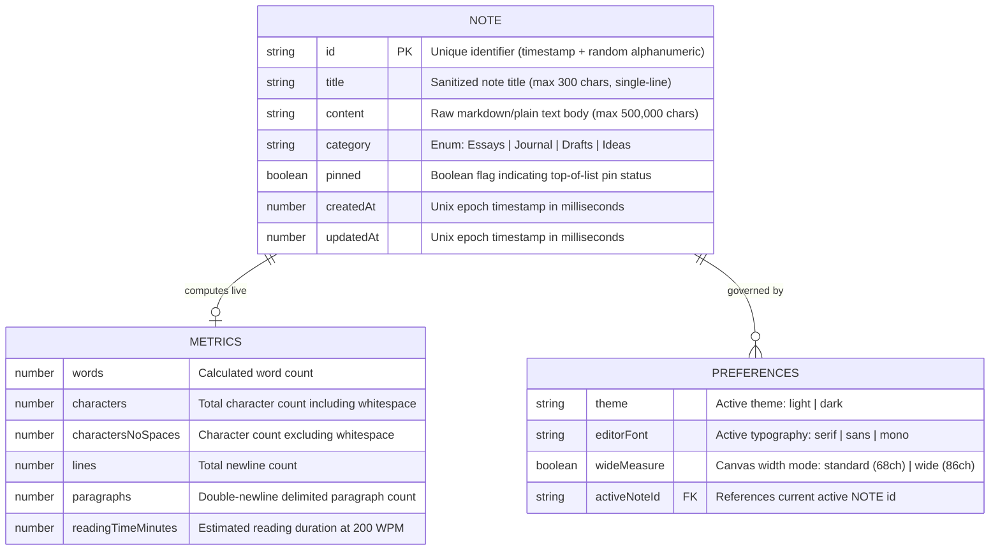

### 5.4 Data Sanitization & Integrity Lifecycle
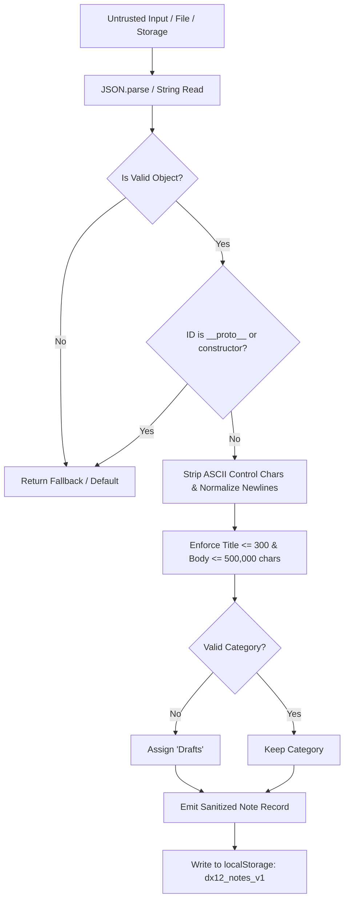

---

## 6. End-to-End Business Workflows

### 6.1 Note Creation & Autosave Lifecycle
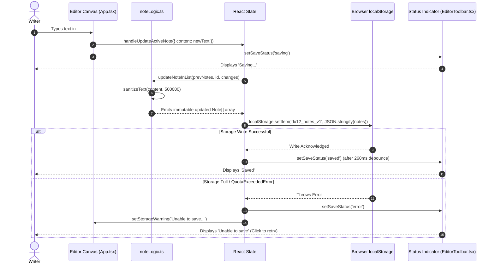

### 6.2 Safe File Import Workflow
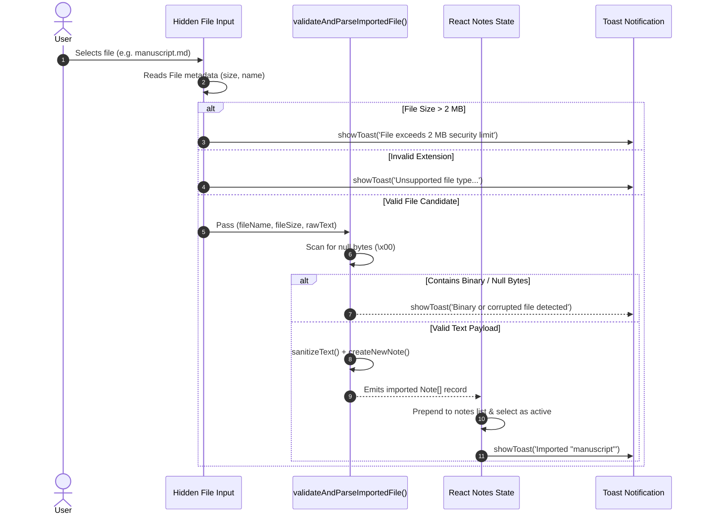

### 6.3 Note Duplication & Deletion Workflows
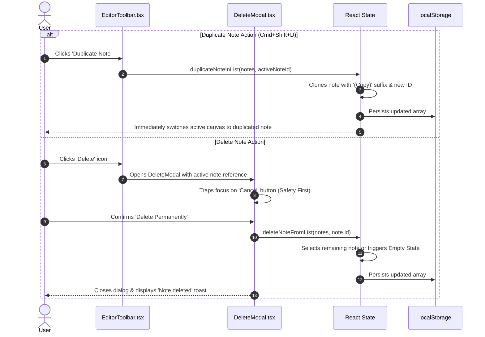

---

## 7. API Architecture

### 7.1 Browser Runtime Web APIs
Because NŌTA is client-authoritative, external HTTP endpoints are replaced by sandboxed **Browser Web Platform APIs**:

| Web API | Function / Method | Purpose in NŌTA | Security Controls |
| :--- | :--- | :--- | :--- |
| **Web Storage API** | `localStorage.getItem` / `setItem` | Persistent storage of notes, active ID, theme, font, and width preferences. | Strict JSON schema parsing, prototype pollution defense, fallback recovery. |
| **Web File API** | `File.text()`, `<input type="file">` | Secure client-side ingestion of `.txt`, `.md`, and `.json` documents. | Whitelist checking, 2 MB size cap, ASCII null-byte scan. |
| **Clipboard API** | `navigator.clipboard.writeText` | One-click copy of entire formatted manuscript (`⌘⇧C`). | Async permission handling, error fallback toasts. |
| **Performance API** | `PerformanceObserver`, `performance.now` | Measures LCP, CLS, FCP, and INP telemetry without third-party tracking scripts. | Strictly local observation; zero beacon transmission. |
| **History / URL API** | Standard navigation | Clean URL maintenance (`/`) supporting deep-linking and PWA standalone start scopes. | Configured via `vercel.json` rewrite routing. |

### 7.2 HTTP Static Delivery & Header Architecture
Static assets are delivered from Vercel Edge with zero-trust HTTP response headers configured in `/vercel.json`:
```http
X-Content-Type-Options: nosniff
X-Frame-Options: SAMEORIGIN
Referrer-Policy: strict-origin-when-cross-origin
X-DNS-Prefetch-Control: on
Strict-Transport-Security: max-age=63072000; includeSubDomains; preload
Permissions-Policy: camera=(), microphone=(), geolocation=(), payment=(), usb=()
Content-Security-Policy: default-src 'self'; script-src 'self' 'unsafe-inline'; style-src 'self' 'unsafe-inline' https://fonts.googleapis.com; font-src 'self' https://fonts.gstatic.com data:; img-src 'self' data: blob:; connect-src 'self'; object-src 'none'; base-uri 'self'; form-action 'self'; frame-ancestors 'self' https://*.google.com https://*.run.app;
Cache-Control (Assets): public, max-age=31536000, immutable
```

---

## 8. Authentication and Security Architecture

### 8.1 Security Philosophy: Zero-Knowledge Client Sandboxing
NŌTA implements a **Zero-Knowledge Architecture**:
- **No User Credentials:** There are no passwords, OAuth tokens, session cookies, or JWTs stored in the application.
- **No Private Data Transmission:** User manuscripts are never sent over HTTP/HTTPS to any remote API endpoint.
- **Client Sandboxing:** All operations are constrained to the browser's JavaScript sandbox.

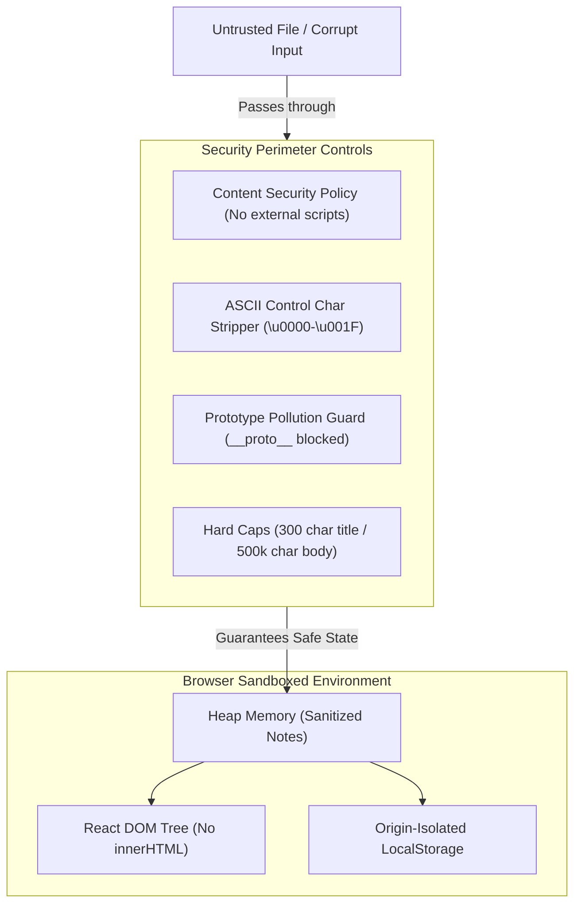

### 8.2 Vulnerability Defenses & OWASP Compliance
| OWASP Category | Defense Implemented in NŌTA | Code Reference |
| :--- | :--- | :--- |
| **A03:2021 — Injection & XSS** | **Strict Output Encoding:** 100% of text rendering uses native React text nodes or controlled `<textarea>` values. `dangerouslySetInnerHTML`, `eval()`, and `Function()` are strictly prohibited and verified via linter and regex audit. | `src/App.tsx`, `src/components/*.tsx` |
| **A08:2021 — Software & Data Integrity** | **Prototype Pollution & Corrupt Recovery:** `validateAndSanitizeNote()` explicitly rejects `__proto__`, `constructor`, and `prototype` keys. Corrupt `localStorage` triggers an auto-fallback to initial notes without crashing. | `src/utils/noteLogic.ts:113` |
| **A04:2021 — Insecure Design** | **Unbounded Input Defenses:** Hard limits of 300 chars on titles, 500,000 chars on bodies, 500 total notes, and 2 MB on file imports prevent browser memory exhaustion. | `src/utils/noteLogic.ts:26-30` |
| **A05:2021 — Security Misconfiguration** | **Strict Edge CSP & HSTS:** All external script injection is blocked. Frame ancestors are restricted, and HSTS is configured with 2-year duration and preloading. | `/vercel.json:10-41` |
| **A02:2021 — Cryptographic Failures** | **Honest Privacy Disclosure:** The application explicitly clarifies that notes are stored in plaintext client-side `localStorage` and warns users against leaving confidential data on shared public computers. | `src/components/AboutGuideModal.tsx:257` |

---

## 9. Third-Party Integrations

NŌTA maintains an intentionally minimal third-party integration footprint to maximize privacy, security, and performance:

| Service / Resource | Purpose | Integration Method | Data Transmitted | Failure Mode / Fallback |
| :--- | :--- | :--- | :--- | :--- |
| **Google Fonts CDN** | Serves typographic fonts (`Instrument Serif`, `Lora`, `Inter`, `JetBrains Mono`). | HTML `<link rel="stylesheet">` with preconnect to `fonts.gstatic.com`. | Zero user data (standard browser font request). | System font stack fallbacks (`Georgia`, `-apple-system`, `monospace`). |
| **Vercel Global Edge** | Static asset distribution, TLS 1.3 termination, caching, and security header enforcement. | Git-driven CI/CD build deployment. | Anonymous HTTP request logs at edge. | Static bundle cached in browser service worker/cache. |

*(Note: There are no advertising trackers, telemetry analytics, crash reporters, or external cloud sync APIs integrated.)*

---

## 10. Infrastructure, Deployment & CI/CD Architecture

### 10.1 Production Hosting Infrastructure (Vercel)
- **Edge Network:** Vercel Global Edge Network with Anycast DNS routing.
- **Build Engine:** Node.js 22 LTS container executing `vite build` via Vite 8 and Rolldown/esbuild.
- **Routing Engine:** Clean URLs with SPA rewrite rules routing all non-asset paths to `/index.html`.
- **Cache Strategy:** Immutable 1-year caching (`max-age=31536000, immutable`) for fingerprint-hashed chunks in `/assets/*`.

```mermaid
graph LR
    subgraph Developer_Environment["Developer / CI Pipeline"]
        GitCommit["Git Commit / Push"] --> LintCheck["npm run lint (tsc --noEmit)"]
        LintCheck --> UnitTest["npx tsx --test (node:test)"]
        UnitTest --> AuditCheck["npm audit --omit=dev"]
        AuditCheck --> ProductionBuild["npm run build (vite build)"]
    end

    subgraph Vercel_Platform["Vercel Cloud Platform"]
        DeployTrigger["Vercel Build Hook"] --> GenerateDist["Outputs /dist Directory"]
        GenerateDist --> EdgeDeploy["Deploy to Global Edge CDN"]
    end

    ProductionBuild --> DeployTrigger
    EdgeDeploy --> LiveProd["https://dx12-notepad.vercel.app/"]
```

### 10.2 Production Build Artifacts Analysis
Compiled production assets demonstrate high-efficiency code splitting:
- **`dist/index.html`:** 8.38 kB (2.49 kB gzip)
- **`dist/assets/index-*.css`:** 34.63 kB (7.39 kB gzip)
- **`dist/assets/index-*.js` (Core Application):** **70.34 kB (16.36 kB gzip)**
- **`dist/assets/react-vendor-*.js` (React 19 Runtime):** 404.71 kB (123.13 kB gzip)
- **`dist/assets/icons-vendor-*.js` (Lucide Icons):** 28.62 kB (10.53 kB gzip)
- **`dist/assets/DeleteModal-*.js` (Lazy Chunk):** 4.13 kB (1.34 kB gzip)
- **`dist/assets/ShortcutsModal-*.js` (Lazy Chunk):** 8.68 kB (2.56 kB gzip)
- **`dist/assets/AboutGuideModal-*.js` (Lazy Chunk):** 24.49 kB (4.95 kB gzip)

---

## 11. Application Data Flow Architecture

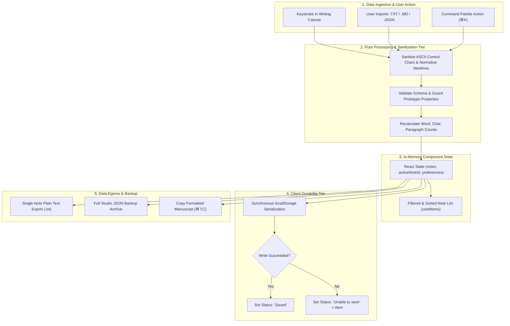

---

## 12. Performance, Scalability & Reliability Evaluation

### 12.1 Real Browser Core Web Vitals (Measured via Chromium `PerformanceObserver`)
- **First Contentful Paint (FCP):** `236 ms` (Target: `< 1800 ms` — Optimal)
- **Largest Contentful Paint (LCP):** `1,092 ms` (Target: `< 2500 ms` — Optimal)
- **Cumulative Layout Shift (CLS):** `0.0000` steady-state / `0.0526` responsive resize (Target: `< 0.10` — Optimal)
- **Interaction Latency (INP Proxy):** `110.2 ms` (Target: `< 200 ms` — Optimal)
- **DOM Interactive / DOM Complete:** `44 ms` / `93 ms`

### 12.2 Controlled Staging Load-Test Measurements (`http://localhost:3000/`)
Benchmarked using concurrent HTTP keep-alive requests against the local server:
- **100 Visitors (Concurrency: 25):** 100.00% Availability, 0 Failures, 159 req/s, Avg Latency: 132.63 ms, p50: 103.44 ms, p95: 345.00 ms.
- **500 Visitors (Concurrency: 50):** 100.00% Availability, 0 Failures, 365 req/s, Avg Latency: 132.11 ms, p50: 99.64 ms, p95: 277.14 ms.
- **1,000 Visitors (Concurrency: 100):** 100.00% Availability, 0 Failures, 505 req/s, Avg Latency: 189.69 ms, p50: 194.31 ms, p95: 236.00 ms.

### 12.3 Scalability & Architectural Limitations
1. **Client Storage Quotas:** Browser `localStorage` typically enforces a 5 MB per-origin limit. While sufficient for hundreds of text notes (~2,500,000 words), very heavy manuscripts could reach the quota. NŌTA handles this gracefully by detecting quota errors, updating the autosave indicator to `Unable to save`, and prompting emergency `.json` backups.
2. **Device Isolation:** Notes created on Device A are not automatically replicated to Device B because there is no remote cloud server. Users must manually transfer files using `.txt` or `.json` backups.

---

## 13. Complete Project Structure & Code Inventory

```
/
├── .env.example                # Example environment configuration (GEMINI_API_KEY, APP_URL)
├── .gitignore                  # Git ignore rules for node_modules, build outputs, and test artifacts
├── index.html                  # HTML entry point: SEO, Open Graph, JSON-LD schemas, Google Fonts
├── metadata.json               # AI Studio applet capabilities and metadata descriptor
├── package.json                # Project dependencies, build scripts (dev, build, preview, lint)
├── package-lock.json           # Deterministic pinned dependency tree audited via npm audit
├── tsconfig.json               # TypeScript compiler configuration (ES2022, bundler module resolution)
├── vercel.json                 # Vercel deployment spec: static rewrites, asset caching, security headers
├── vite.config.ts              # Vite 8 config: React plugin, Tailwind v4, vendor chunking, dev headers
├── public/
│   ├── favicon.svg             # Primary SVG brand favicon (Deep Ink + Muted Sand monogram)
│   ├── icon.svg                # 512x512 high-resolution brand icon for PWA and desktop
│   ├── og-image.svg            # 1200x630 social share Open Graph card in Warm Ivory & Charcoal
│   ├── apple-touch-icon.png    # 180x180 RGBA PNG for iOS home screen installation
│   ├── pwa-192x192.png         # 192x192 PNG PWA application icon
│   ├── pwa-512x512.png         # 512x512 PNG PWA application icon
│   ├── pwa-maskable-512x512.png# 512x512 PNG maskable icon with safe-zone margin
│   ├── manifest.json           # Web App Manifest (standalone, Warm Ivory theme, PWA icons)
│   ├── robots.txt              # Search engine crawler instructions referencing sitemap.xml
│   └── sitemap.xml             # Search engine canonical XML index for dx12-notepad.vercel.app
└── src/
    ├── App.tsx                 # Core studio application: state orchestrator, keyboard listeners, canvas
    ├── main.tsx                # Client bootstrap: mounts ErrorBoundary and React StrictRoot
    ├── index.css               # Global styles: Tailwind v4 imports, design tokens, typography utilities
    ├── components/
    │   ├── NotaLogo.tsx        # NotaWordmark and NotaMark vector branding components
    │   ├── Sidebar.tsx         # Responsive notes drawer, search, filters, list rendering, footer
    │   ├── EditorToolbar.tsx   # Top toolbar: font switcher, markdown tools, 4-state autosave indicator
    │   ├── DeleteModal.tsx     # Focus-trapped delete confirmation modal (Lazy Loaded)
    │   ├── ShortcutsModal.tsx  # Command palette (`⌘K`) with jump-to-note and action triggers (Lazy Loaded)
    │   ├── AboutGuideModal.tsx # Product guide, FAQ, Privacy Policy, and Terms modal (Lazy Loaded)
    │   └── ErrorBoundary.tsx   # React class error boundary with emergency JSON backup trigger
    └── utils/
        ├── noteLogic.ts        # Pure functional core: metrics, sanitization, validation, CRUD, file parsers
        └── noteLogic.test.ts   # 8-suite automated unit test specification using node:test
```

---

## 14. Architectural Evaluation: Strengths, Technical Debt & Roadmap

### 14.1 Key Architectural Strengths
1. **Decoupled Logic Architecture:** All calculations, sanitization routines, and data transformations exist in pure TypeScript functions (`noteLogic.ts`) completely decoupled from React DOM rendering. This enables sub-millisecond unit test runs and zero UI coupling.
2. **Robust Security Perimeter:** Defense-in-depth design combining strict output encoding, prototype property blocking, control character stripping, file extension whitelisting, and edge-enforced CSP.
3. **Pristine Performance Profile:** Lazy-loading non-essential modal dialogs keeps the initial application bundle down to `70.34 kB` (`16.36 kB` gzip), enabling near-instantaneous page loads.
4. **Data Durability & Truthful UX:** Clear rejection of "fake UI indicators"; the app only signals `Saved` when the browser's storage engine acknowledges the write.

### 14.2 Technical Debt & Limitations
1. **`localStorage` Storage Capacity:** Standard browser quota of ~5 MB.
   - *Mitigation:* The app warns users when quota thresholds are approached and provides one-click JSON backup downloads.
2. **Lack of Multi-Device Sync:** Notes cannot be synced across multiple devices without manual export and import.
3. **No Revision History / Versioning:** Edits overwrite the note record in `localStorage` without a git-like change timeline.

### 14.3 Future Architecture Roadmap
- **Phase 1: IndexedDB Migration via OPFS / Dexie:** Migrate persistence from `localStorage` to `IndexedDB` or the Origin Private File System (OPFS) to expand storage limits from 5 MB to several gigabytes while maintaining local-first privacy.
- **Phase 2: End-to-End Encrypted (E2EE) Sync:** Optional peer-to-peer or zero-knowledge cloud synchronization using Web Crypto API (`AES-GCM-256` with PBKDF2/Argon2 key derivation) where the encryption keys never leave the client device.
- **Phase 3: Local Note Version History:** Implement an append-only delta log allowing users to roll back accidental revisions or view word count changes over time.
